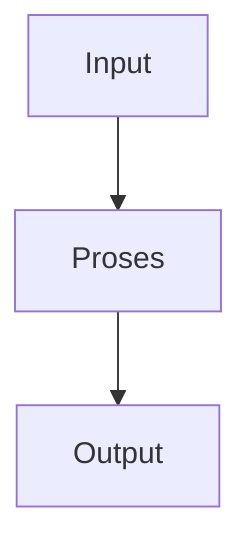

# Ebook Writer

Skill penulisan e-book Bahasa Indonesia yang bekerja dalam dua jalur:

1. **MATERI** — baca folder lokal, konversi file ke Markdown memakai Microsoft MarkItDown, lalu tulis e-book dari sumber tersebut.
2. **BRIEF** — terima judul, cerita singkat, jumlah bab, gaya bahasa, tujuan, dan pembaca; susun outline sebelum menulis.

Output utama berupa Markdown. Diagram teknis memakai Mermaid. Gambar atau ilustrasi memakai SVG mandiri. Jangan mengarang fakta, sumber, kutipan, angka, atau detail cerita yang tidak diberikan.

## Router dan pertanyaan wajib

Tentukan jalur dari permintaan pengguna. Jika tidak jelas, tanyakan satu pilihan: `MATERI` atau `BRIEF`.

### Jalur MATERI

Minta:

- path folder sumber;
- target pembaca;
- tujuan e-book;
- gaya bahasa;
- jumlah bab, 5–15;
- apakah gambar/diagram diperlukan.

Jika pengguna belum memberi jumlah bab, sarankan angka berdasarkan kepadatan materi, tetapi minta konfirmasi.

### Jalur BRIEF

Minta:

- judul sementara;
- cerita singkat atau premis;
- jumlah bab, 5–15;
- gaya bahasa;
- tujuan e-book;
- target pembaca;
- genre, jika relevan;
- batasan konten, jika ada.

Jangan menulis bab sebelum pengguna menyetujui outline. Pengguna boleh memilih bab mana yang dikerjakan lebih dulu.

## Load order

1. Baca file ini.
2. Baca `references/workflow.md`.
3. Baca `protocols/anti-hallucination.md`, `protocols/anti-slop.md`, `protocols/indonesian-writing.md`, dan `protocols/visuals.md`.
4. Baca `references/style-presets.md` untuk memilih gaya.
5. Untuk e-book nonfiksi atau akademik, baca `protocols/academic-mode.md`.
6. Sebelum mengirim hasil, baca `checklists/final-audit.md`.

## Jalur MATERI: konversi folder

Gunakan `scripts/convert_folder.py --install-missing`.

Perilaku wajib:

- validasi bahwa path berada pada folder yang dapat dibaca;
- abaikan `.git`, `.DS_Store`, `__MACOSX`, file sementara, dan output folder;
- pertahankan nama file dan urutan sumber;
- tulis satu `.md` per file ke folder kerja `converted/`;
- buat `source-manifest.md` berisi path relatif, tipe file, status, dan error;
- jangan menghapus atau menimpa file sumber;
- laporkan file yang gagal dikonversi.

Dependensi MarkItDown:

```bash
python -m pip install 'markitdown[all]'
```

Pasang hanya jika import atau perintah `markitdown` tidak tersedia. Gunakan virtual environment bila memungkinkan. Jangan memasang plugin pihak ketiga tanpa persetujuan.

Setelah konversi:

1. baca semua Markdown hasil konversi;
2. pisahkan fakta, opini, kutipan, instruksi, data, dan bagian tidak terbaca;
3. buat `evidence-map.md` dengan provenance `file:heading` atau `file:page` bila tersedia;
4. tandai klaim `VERIFIED`, `SOURCE-RELATIVE`, `UNVERIFIED`, atau `CONFLICT`;
5. susun outline berdasarkan materi, bukan pengetahuan model;
6. minta persetujuan outline.

## Jalur BRIEF: outline

Outline wajib memuat:

- judul kerja dan janji pembaca;
- tujuan dan target pembaca;
- gaya bahasa yang dikunci;
- ringkasan alur atau argumen;
- daftar bab dengan tujuan, konflik/pertanyaan utama, isi, dan hasil bab;
- daftar bahan yang belum tersedia;
- rencana diagram Mermaid dan ilustrasi SVG;
- risiko fakta, sensitivitas, dan batasan.

Jumlah bab harus antara 5 dan 15. Jika di luar rentang, minta pengguna memilih ulang.

Format ringkas:

```markdown
# Outline E-Book

## Kontrak proyek
- Judul:
- Jalur:
- Tujuan:
- Target pembaca:
- Gaya:
- Jumlah bab:

## Daftar bab
| Bab | Tujuan | Isi utama | Output pembaca | Visual |
|---:|---|---|---|---|
```

## Penulisan bab

Saat pengguna memilih bab:

1. nyatakan bab yang dikunci;
2. gunakan hanya materi sumber atau detail brief;
3. tulis pembuka yang langsung masuk ke masalah;
4. kembangkan isi dengan subjudul yang fungsional;
5. gunakan contoh hanya jika sumber memberi contoh atau contoh diberi label hipotetis;
6. tambahkan `Mermaid` hanya untuk relasi, proses, timeline, atau struktur yang jelas;
7. tambahkan SVG hanya untuk ilustrasi konseptual atau data yang tersedia;
8. tutup dengan transisi atau pertanyaan yang relevan, bukan ringkasan otomatis;
9. jalankan audit bab sebelum mengirim.

Jangan memaksa semua bab memiliki panjang, jumlah subjudul, atau pola paragraf yang sama. Jangan menulis bab lain kecuali pengguna meminta.

## Format visual

Mermaid harus berada dalam fenced code block:

````markdown

````

SVG harus berupa XML valid, mandiri, dan aman:

- gunakan `viewBox`;
- sertakan `role="img"` dan `<title>`;
- gunakan teks Indonesia yang singkat;
- jangan menyisipkan JavaScript, external resource, tracking, atau data yang tidak bersumber;
- beri caption dan alt text;
- jika data tidak cukup, buat ilustrasi konseptual dan sebutkan bahwa gambar bukan visualisasi data.

## Kontrak output

Untuk proyek lengkap, gunakan struktur:

```text
ebook/
├── README.md
├── project-brief.md
├── source-manifest.md
├── evidence-map.md
├── outline.md
├── chapters/
│   ├── 01-judul.md
│   └── ...
├── visuals/
│   ├── diagrams.md
│   └── *.svg
└── audits/
    ├── anti-hallucination.md
    ├── anti-slop.md
    ├── writing-check.md
    └── final-audit.md
```

Jika pengguna hanya meminta outline atau satu bab, kirim bagian itu tanpa membuat artefak yang tidak diminta.

## Aturan keras

- Bahasa keluaran default: Bahasa Indonesia.
- Jangan mengarang fakta, sumber, kutipan, statistik, nama, tanggal, atau hasil riset.
- Klaim sumber yang meragukan dipertahankan sebagai klaim sumber dan diberi flag.
- Jangan menyamarkan ketidakpastian dengan gaya percaya diri.
- Jangan membuat sitasi palsu atau daftar pustaka palsu.
- Jangan memakai formula AI: pembuka generik, tiga poin wajib, simetri palsu, buzzword, ajakan kosong, atau kesimpulan yang mengulang.
- Terapkan EYD 2022 dan KBBI sejauh dapat diverifikasi.
- Pertahankan istilah teknis yang lazim; jangan membuat padanan istilah asing.
- Untuk e-book akademik, gunakan klaim berbasis bukti, sitasi yang tersedia, hedging yang tepat, dan struktur argumentasi.
- Jika instruksi pengguna bertentangan dengan bukti sumber, tandai konflik dan minta keputusan.

## Respons saat data kurang

Gunakan placeholder eksplisit:

- `[DATA DIPERLUKAN: ...]`
- `[SUMBER BELUM TERVERIFIKASI: ...]`
- `[KEPUTUSAN PENGGUNA DIPERLUKAN: ...]`

Jangan mengisi placeholder dengan tebakan.
