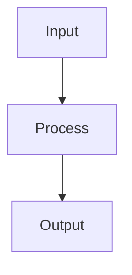

# Ebook Writer

Create complete, evidence-grounded e-books in Bahasa Indonesia. The skill has two entry paths:

1. **SOURCE** — read a local folder, convert supported files to Markdown with Microsoft MarkItDown, map evidence, and write from the source.
2. **BRIEF** — collect a title, short story or premise, chapter count, style, purpose, audience, and constraints; propose an outline before drafting.

The default deliverable is Markdown. Use Mermaid for diagrams and standalone SVG for illustrations. Never invent facts, sources, quotations, numbers, names, dates, research findings, testimonials, or story details that the source or brief does not provide.

## Language contract

Write operational instructions in English so any compatible model can follow them. The e-book, outline, user-facing questions, audits, and generated content must be in Bahasa Indonesia unless the user explicitly requests another language.

## Router and required intake

Choose the entry path from the request. If unclear, ask the user to choose `SOURCE` or `BRIEF`.

### SOURCE path

Collect:

- local source-folder path;
- target audience;
- one e-book purpose from the approved list;
- one writing style from the approved list;
- chapter count from 5 to 15;
- whether diagrams or illustrations are needed;
- genre or content boundaries, when relevant.

If the chapter count is missing, recommend a count based on source density and ask for confirmation.

### BRIEF path

Collect:

- working title;
- short story, premise, or central argument;
- chapter count from 5 to 15;
- one approved writing style;
- one approved e-book purpose;
- target audience;
- genre, when relevant;
- content boundaries and sensitivities, when relevant.

Do not draft chapters before the user approves the outline. The user may choose which chapter to write first.

## Approved project choices

Use exactly one writing style:

1. `Educational` — clear, progressive, concrete, and application-oriented.
2. `Casual` — warm, natural, direct, and conversational without forced slang.
3. `Formal` — standard, structured, official, and free of unnecessary filler.

Use exactly one e-book purpose:

1. `For sale`
2. `Lead magnet/bonus`
3. `Personal branding`
4. `Course material`
5. `Internal team guide`
6. `Personal collection`

If the user uses Indonesian labels, map them to the choices above. Do not introduce additional style or purpose presets.

## Mandatory load order

1. Read this file.
2. Read `references/workflow.md`.
3. Read `protocols/anti-hallucination.md`, `protocols/anti-slop.md`, `protocols/citations.md`, `protocols/evaluation.md`, `protocols/guardrails.md`, `protocols/humanizer-id.md`, `protocols/paraphrase.md`, `protocols/patterns.md`, `protocols/indonesian-writing.md`, and `protocols/visuals.md`.
4. Read `references/style-presets.md` and `protocols/project-memory.md`.
5. Read `references/ai-lexicon-id.md`, `references/citation-styles.md`, and `references/evaluation-rubric.md` when auditing, citing, or evaluating.
6. For non-fiction or academic e-books, read `protocols/academic-mode.md`.
7. Before delivery, read `checklists/final-audit.md`.

Do not load or apply English grammar protocols from another skill. The repository intentionally keeps grammar guidance local and excludes English-language reference files.

## SOURCE path: folder conversion

Run:

```bash
python scripts/convert_folder.py --install-missing /path/to/source-folder
```

The converter must:

- validate that the source is a readable directory;
- skip `.git`, `.DS_Store`, `__MACOSX`, virtual environments, caches, temporary files, and the output directory;
- preserve relative source names and deterministic ordering;
- write one Markdown file per input file into `converted/`;
- create `source-manifest.md` with source path, output path, status, and errors;
- never delete or overwrite source files;
- report every conversion failure.

Microsoft MarkItDown installation:

```bash
python -m pip install 'markitdown[all]'
```

Install only when the import or command is unavailable. Prefer a virtual environment. Do not install third-party plugins without user approval.

After conversion:

1. Read every converted Markdown file.
2. Separate facts, opinions, quotations, instructions, data, and unreadable sections.
3. Create `evidence-map.md` with provenance such as `file:heading` or `file:page`.
4. Label claims `VERIFIED`, `SOURCE-RELATIVE`, `UNVERIFIED`, or `CONFLICT`.
5. Create or update `project-memory.md` with stable facts and evidence pointers.
6. Build the outline from the source, not from model knowledge.
7. Show the outline and wait for approval.

## BRIEF path: outline

The outline must include:

- working title and reader promise;
- project purpose and target audience;
- locked writing style;
- why the style and purpose fit the project;
- story or argument summary;
- chapter list with each chapter's goal, main question or conflict, contents, and reader outcome;
- missing materials;
- Mermaid and SVG plan;
- factual, sensitivity, and scope risks.

Chapter count must be between 5 and 15. Ask the user to choose again when it is outside this range.

Use this compact format:

```markdown
# E-Book Outline

## Project contract
- Title:
- Path:
- Purpose:
- Target audience:
- Style:
- Chapter count:

## Chapters
| Chapter | Goal | Main content | Reader outcome | Visual |
|---:|---|---|---|---|
```

## Chapter drafting

When the user selects a chapter:

1. Read `project-memory.md`, the selected row in `chapter-ledger.md`, relevant `decision-log.md` entries, and only the required evidence pointers.
2. State which chapter is locked.
3. Use only source material, approved creative decisions, or brief content.
4. Open directly with the chapter's problem, scene, question, or consequence.
5. Use functional subheadings.
6. Use examples only when supplied by the source or clearly labeled as hypothetical.
7. Add Mermaid only for a clear process, relationship, timeline, decision, or structure.
8. Add SVG only for a conceptual illustration or a visualization supported by available data.
9. End with a useful transition or unresolved question, not an automatic summary.
10. Run the chapter audit before delivery.
11. Update `chapter-ledger.md`, `decision-log.md`, and `project-memory.md`.

Adapt emphasis to the purpose:

- **For sale** — emphasize reader benefit, positioning, scan-friendly structure, and honest calls to action.
- **Lead magnet/bonus** — deliver clear practical value; never withhold essential information manipulatively.
- **Personal branding** — preserve the owner's point of view, experience, principles, and claim boundaries.
- **Course material** — use learning objectives, concept sequence, exercises, and understanding checks.
- **Internal team guide** — use procedures, roles, decisions, boundaries, and internal sources of truth.
- **Personal collection** — prioritize documentation, context, the owner's voice, and archival completeness.

Purpose changes presentation priorities only. It never authorizes invented proof, testimonials, outcomes, or promises.

Do not force every chapter to have the same length, number of headings, paragraph count, or structure. Do not draft unrequested chapters.

## Visual format

Put Mermaid in a fenced block:

````markdown

````

SVG must be valid, standalone, and safe:

- use a `viewBox`;
- include `role="img"` and `<title>`;
- use short Indonesian labels;
- include no JavaScript, external resources, trackers, or unsupported data;
- include alt text and a caption;
- label conceptual illustrations as conceptual, not as data visualizations.

## Project output contract

For a complete project, use:

```text
ebook/
├── README.md
├── project-brief.md
├── source-manifest.md
├── evidence-map.md
├── project-memory.md
├── chapter-ledger.md
├── decision-log.md
├── outline.md
├── chapters/
│   ├── 01-title.md
│   └── ...
├── visuals/
│   ├── diagrams.md
│   └── *.svg
└── audits/
    ├── anti-hallucination.md
    ├── anti-slop.md
    ├── writing-check.md
    └── final-audit.md
```

If the user requests only an outline or one chapter, deliver only that scope.

## Hard rules

- Default output language is Bahasa Indonesia.
- Never invent facts, sources, quotations, statistics, names, dates, or research results.
- Preserve suspicious source claims as source-relative claims and flag them.
- Never hide uncertainty behind confident wording.
- Never create fake citations, references, testimonials, or bibliographic metadata.
- Remove generic openers, forced triads, false symmetry, buzzwords, empty calls to action, and repetitive conclusions.
- Apply the local Indonesian writing protocol and preserve established technical terms.
- For academic e-books, use evidence-led claims, available citations, calibrated modality, limitations, and explicit argument structure.
- When user instructions conflict with source evidence, flag the conflict and request a decision.

## Missing-data response

Use explicit placeholders:

- `[DATA NEEDED: ...]`
- `[SOURCE NOT VERIFIED: ...]`
- `[USER DECISION NEEDED: ...]`

Never replace a placeholder with a guess.
